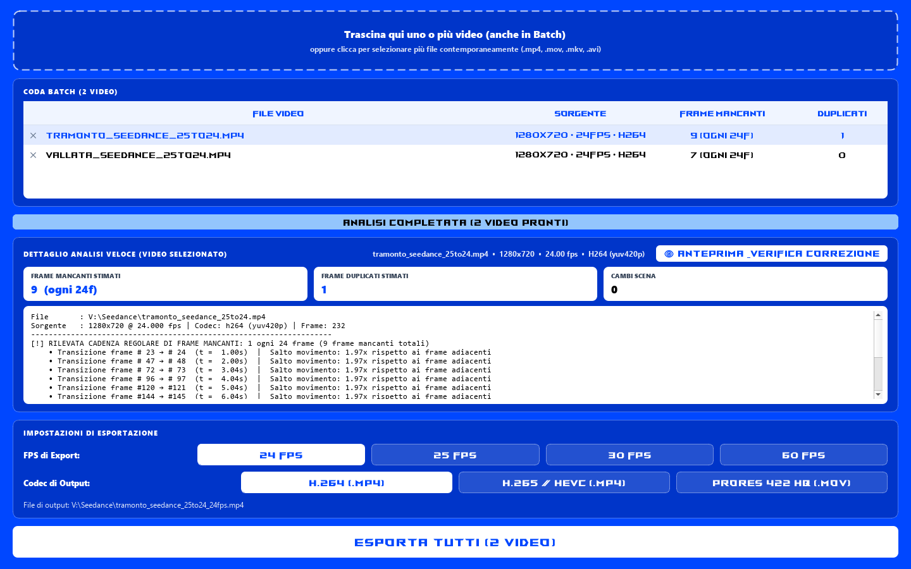
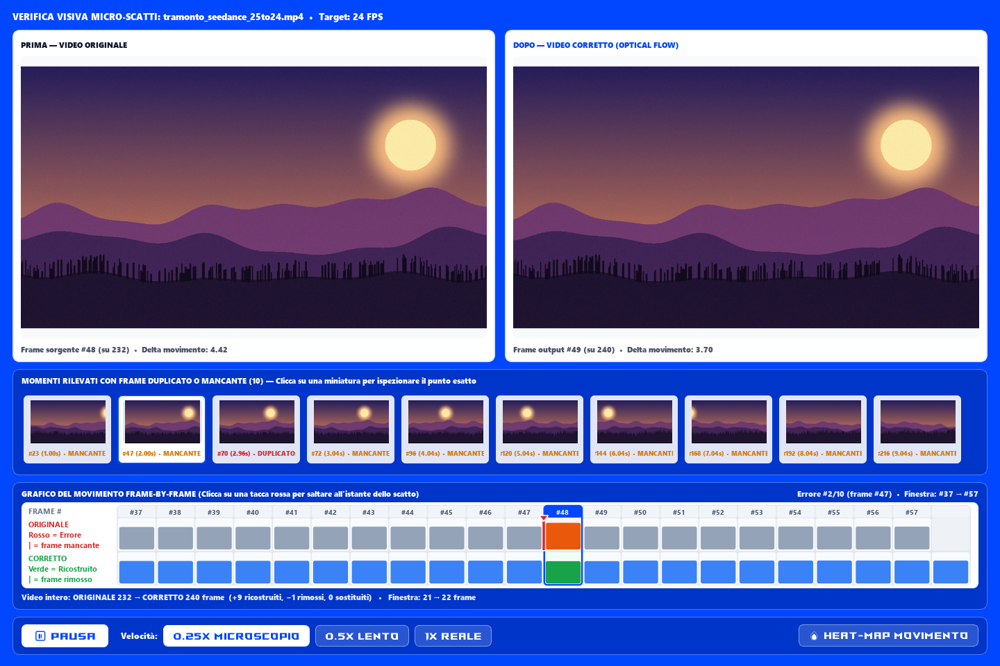
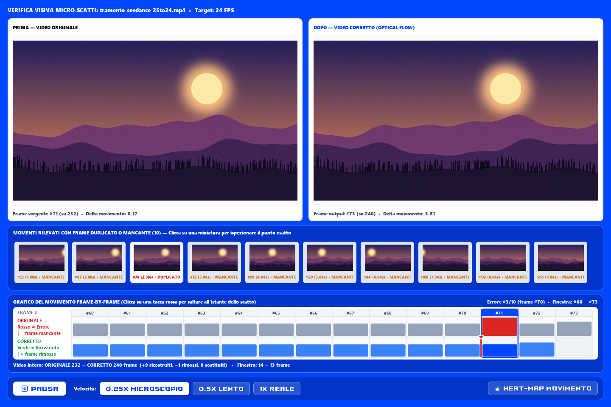
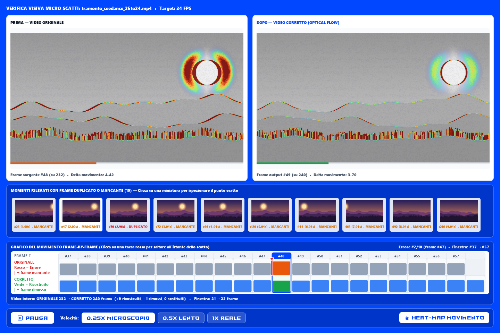

<p align="center">
  
</p>

<h1 align="center">MONOVIDEOFIX v1.6</h1>
<p align="center">
  <strong>Seedance FPS & Judder Repair Tool</strong><br>
  Strumento desktop con interfaccia grafica (PyQt5) e CLI per l'analisi automatica e la correzione chirurgica di scattini (<em>judder</em>), frame persi e frame duplicati nei video (es. conversioni errate 25 → 24 fps).
</p>


---

## 📸 Screenshot

### Coda batch e analisi
Trascina uno o più video: l'analisi parte da sola e riconosce la cadenza dei frame persi (qui *1 ogni 24*, tipica di una conversione 25 → 24 fps) e i frame duplicati.

<p align="center"></p>

### Anteprima Prima / Dopo: frame mancante
Il riquadro *Dopo* contiene il frame ricostruito con optical flow (cella verde nella timeline). Nell'*Originale* i frame scorrono senza buchi e la **lineetta rossa** indica dove mancava il fotogramma. Sotto la timeline: i totali reali del video, `ORIGINALE 232 → CORRETTO 240 frame`.

<p align="center"></p>

### Anteprima Prima / Dopo: frame duplicato
Il duplicato (cella rossa nell'*Originale*) viene rimosso dal video corretto; la lineetta rossa nella corsia *Corretto* segna il punto in cui è stato tolto.

<p align="center"></p>

### Heat-Map Movimento
La mappa termica evidenzia quanto si muove ogni zona tra un frame e il successivo: un salto di movimento (frame mancante) risulta molto più "caldo" a sinistra che nel video corretto a destra.

<p align="center"></p>

---

## ✨ Caratteristiche Principali

- **Rilevamento Automatico con Optical Flow (Lucas-Kanade + MAD)**:
  - Individua **frame mancanti** (salti di movimento anomali ~2x rispetto ai fotogrammi adiacenti) e rileva automaticamente eventuali **cadenze periodiche** (es. 1 frame perso ogni 24 fotogrammi), con aggancio di fase che segue la cadenza anche quando un duplicato o un taglio la sposta di un fotogramma.
  - Individua **frame duplicati / congelati** (freeze frames).
  - Riconosce ed esclude automaticamente i **cambi di inquadratura (scene cuts)** per evitare artefatti tra scene diverse.
- **Anteprima & Verifica Diagnostica Prima / Dopo (`👁 Anteprima & Verifica Correzione`)**:
  - **Confronto Side-by-Side sincronizzato** tra il video *Originale* e il video *Corretto (Optical Flow)*.
  - **Zoom & Pan Sincronizzati tra i Frame di Confronto**: usa la rotellina del mouse per zoomare fino a `8x` sul punto sotto il cursore, trascina per spostarti nell'inquadratura e fai doppio click per tornare al 100%; lo zoom e lo spostamento vengono replicati istantaneamente anche sul frame di confronto affiancato.
  - **Galleria Thumbnail Cliccabili dei Momenti Anomali (1 Thumbnail = 1 Singolo Errore)**: mostra le anteprime visive di tutti gli istanti in cui si verifica un **frame duplicato** o **frame mancante**; selezionando una thumbnail viene caricato uno spezzone mirato centrato esclusivamente su quel singolo errore.
  - **Rallentatore "Microscopio" (`0.25x` / `0.5x` / `1x`) + Navigazione frame da tastiera (`←` / `→`)**: rende palese a occhio nudo ogni frame ripetuto o salto risolto.
  - **Riquadri Prima / Dopo senza distrazioni**: bordo neutro fisso, nessun badge o colore che cambi durante la riproduzione; le anomalie sono segnalate solo nella timeline.
  - **Conteggio frame reale (Originale ≠ Corretto) con riproduzione continua**: ogni corsia riproduce *solo* i propri fotogrammi reali, senza grafiche o frame di riempimento che disturbino il confronto in playback; dove manca un frame (Originale) o è stato rimosso un duplicato (Corretto) i frame successivi scorrono a sinistra e la timeline mostra una **lineetta rossa** nel punto esatto. Sotto la timeline sono indicati i totali reali del video esportato (es. `ORIGINALE 1200 → CORRETTO 1250 frame (+50 ricostruiti, −0 rimossi)`).
  - **Timeline a Celle Contigue Frame-by-Frame**: rappresenta ogni fotogramma come un blocco contiguo a larghezza piena (senza spazi vuoti fuorvianti), con numero di frame e cursore a cornice perfettamente sovrapposto alla cella del fotogramma corrente sia per l'Originale che per il Corretto.
  - **Modalità `🔥 Heat-Map Movimento`**: sovrappone una mappa termica (`Turbo`: Blu → Ciano → Giallo → Rosso) ai soggetti in movimento sulla scena desaturata; quando un frame è congelato/ripetuto, la mappa termica si spegne completamente con allerta `0% MOVIMENTO - FRAME FERMO`.
- **Ricostruzione Chirurgica a 16-bit (Zero Degrado sui Frame Originali)**:
  - **100% Bit-Exact sui frame sani**: tutti i fotogrammi originali vengono copiati intatti senza alcuna alterazione o sfocatura.
  - **Interpolazione DIS Optical Flow bidirezionale**: ricostruisce *esclusivamente* i fotogrammi mancanti o sostituisce i fotogrammi duplicati tramite flusso ottico denso bidirezionale (`cv2.DISOpticalFlow`) con pesatura di occlusione forward-backward.
  - **Pipeline a 16-bit per canale (`rgb48le`)**: preserva fedelmente la profondità colore a 10-bit (`yuv420p10le`, spazio colore BT.709) e mantiene eventuale audio presente nel file sorgente.
- **Elaborazione Singola e Batch (Drag & Drop)**:
  - Trascina uno o più file video (`.mp4`, `.mov`, `.mkv`, `.avi`, `.webm`, `.m4v`, `.mpg`, `.mpeg`) o intere cartelle nella coda di lavoro.
  - Configura **FPS di uscita** (`24`, `25`, `30`, `60` fps) e **Codec** (`H.264`, `H.265 / HEVC 10-bit`, `Apple ProRes 422 HQ`), applicati automaticamente a tutti i video caricati nella coda.
- **Avvio Rapido Intelligente (Smart FFmpeg Lookup & Cache)**:
  - Il singolo file `.exe` include `ffmpeg.exe` e `ffprobe.exe` ma **non li estrae ad ogni apertura**: controlla prima se sono già presenti nel sistema (`PATH`) o nella cache locale (`%LOCALAPPDATA%\MonoVideoFix\bin`), aprendo la finestra quasi istantaneamente.

---

## 🚀 Download ed Esecuzione Rapida (Windows Standalone `.exe`)

Non è necessario installare Python, OpenCV o FFmpeg:

1. Scarica **`MONOVIDEOFIX_v1.6.exe`** dalla sezione [**Releases**](https://github.com/AronForti/monovideofix/releases/latest).
2. Avvia **`MONOVIDEOFIX_v1.6.exe`** con un doppio clic (il singolo file `.exe` include già Python, PyQt5, OpenCV, `ffmpeg.exe` e `ffprobe.exe`).
3. Trascina i video nella finestra: l'analisi partirà automaticamente.
4. Clicca su **`👁 Anteprima & Verifica Correzione`** per ispezionare tramite le thumbnail dei momenti anomali, lo zoom sincronizzato, il rallentatore (`0.25x`) o la **Heat-Map Movimento** la risoluzione dei frame mancanti/duplicati.
5. Scegli gli **FPS** e il **Codec** desiderati (applicati automaticamente a tutta la coda) e clicca su **ESPORTA**.
6. I video corretti verranno salvati nella stessa cartella degli originali con il suffisso `_[fps]fps` (es. `video_24fps.mp4` o `video_24fps.mov`).

---

## 🛠️ Utilizzo da Codice Sorgente (Python)

### Requisiti
- **Python 3.10+**
- **FFmpeg & FFprobe** installati nel `PATH` di sistema (oppure copiati nella cartella del progetto)

### Installazione dipendenze
```powershell
pip install -r requirements.txt
```

### Avvio Interfaccia Grafica (GUI)
```powershell
python video_judder_gui.py
```
*(Su Windows puoi anche fare doppio clic su `Avvia_GUI.bat`)*

### Utilizzo da Riga di Comando (CLI)
È disponibile anche lo script CLI `fix_video_judder.py`:
```powershell
# Esegui analisi e correzione automatica
python fix_video_judder.py input_video.mp4 -o output_fixed.mp4

# Solo analisi (senza esportazione)
python fix_video_judder.py input_video.mp4 --analyze-only

# Mantieni il conteggio frame originale e specifica il bitrate
python fix_video_judder.py input_video.mp4 --keep-frame-count --bitrate 20M
```

---

## 📦 Compilazione dell'Eseguibile Singolo (`.exe`)

Per rigenerare l'eseguibile standalone a singolo file con PyInstaller (includendo automaticamente `ffmpeg.exe` e `ffprobe.exe` con estrazione on-demand):

```powershell
pyinstaller --noconfirm --clean MONOVIDEOFIX_v1.6.spec
```
Il file compilato verrà generato in `dist\MONOVIDEOFIX_v1.6.exe`.

---

## 📁 Struttura del Progetto

| File | Descrizione |
| :--- | :--- |
| `video_judder_gui.py` | Applicazione desktop GUI (PyQt5) con supporto Drag & Drop, Preview Prima/Dopo e coda Batch |
| `fix_video_judder.py` | Script CLI per analisi ottica e riparazione judder da terminale |
| `MONOVIDEOFIX_v1.6.spec` | Configurazione PyInstaller per la creazione del singolo file `.exe` con FFmpeg on-demand |
| `requirements.txt` | Elenco delle dipendenze Python del progetto |
| `LEGGIMI.txt` | Guida rapida per l'utente finale |
| `monovideofix.ico` / `assets/icon.svg` | Icone dell'applicazione |
| `assets/screenshots/` | Screenshot dell'interfaccia usati in questo README |
